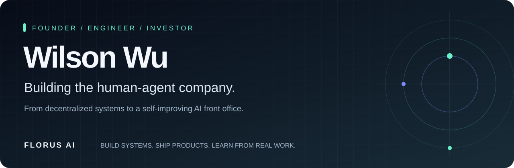
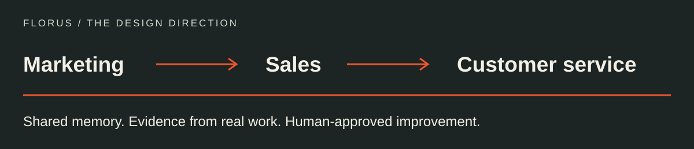

<a href="https://www.linkedin.com/in/wilson-wu-6a08893ba/"><strong>LINKEDIN ↗</strong></a> &nbsp;&nbsp; / &nbsp;&nbsp;
<a href="https://www.florus.ai/"><strong>FLORUS AI ↗</strong></a> &nbsp;&nbsp; / &nbsp;&nbsp;
<a href="#selected-work">SELECTED WORK ↓</a>

### I build the product. And the business around it.

I'm **Wilson Wu**, founder of **Florus AI**, self-taught developer, angel investor and consultant. My path runs through launchpads, liquidity infrastructure and AI products. The thread connecting them: turning an original idea into something people can use.

**11 years working. 5 years building companies full-time.** A master's in Logistics and Supply Chain Management taught me to think in systems. Teaching myself to code gave me a way to build them.

---

## Now / Florus AI
### Building the human-agent company, starting at the front office.

A customer asks a question. Sales learns something. Marketing should not have to discover it again.

That is the direction of **Florus AI**: a self-improving AI front office connecting marketing, sales and customer service. **Our RSI agent workflow** is designed to execute work, measure results, review evidence and carry approved lessons into the next round.

**[GEOCompanion ↗](https://www.geocompanion.ai/)**  
AI search visibility. Helping businesses understand how they are discovered.

**[LaunchVibes ↗](https://www.launchvibes.tech/)**  
Content and distribution. Turning ideas into go-to-market work.

The GTM loop is live through these products. Sales and customer-service loops are in early access; we are developing the connections between them. The ambition is a small human-agent team with the capability to build and run a much larger business.

<strong>Program journey & how I think about self-improvement</strong>

 

NVIDIA Inception · Startup Foundry · LvlUp Startup Excellence Tracks · AltaLab Online Sprint (completed).

Our approach to self-improvement is practical: retain useful evidence, review what worked, and make the next round better. People stay accountable for brand, claims, pricing and spend. This describes our agent workflow and product direction, not frontier-model RSI or achieved superintelligence. Program participation is not investment or endorsement.

---

## Before / Systems, products, ventures

**Honeypot Finance · Founder**  
Launchpad and liquidity infrastructure in the Berachain ecosystem. Work spanning token launches, vaults and the mechanisms that connect projects with liquidity.

**CosmoStarter · Co-founder & CTO**  
Technical co-founding and product building.

**Antslabor · Co-founder & CTO**  
Technical co-founding and engineering leadership.

**Splatter Protocol / Toro DEX**  
DeFi product development on Scroll; trading infrastructure in the Sei ecosystem.

Building in crypto sharpened my interest in the parts outside the interface: incentives, risk, coordination and what happens when real people use a system.

---

## Backing / Founders with original ideas
**Angel investor · 2024–present**

**RootsFi → Pons** &nbsp; / &nbsp; **IVX → Starcap**

I began backing Web3 founders. I'm also looking at AI projects with strong fundamentals, thoughtful technical choices and a clear reason to exist.

---

## Alongside / Helping other founders build

I work across product design, technical execution, launch strategy and operations. Sometimes that means designing the mechanism. Sometimes it means helping a team get it into the world.

### DODO Exchange
**≈1M TVL through my network.** Helped with vault setup and multiple technical integrations on Berachain.

### Narra Layer → Supernet AI
**A vault that helped keep the team operating.** Designed and helped build a specialized vault that generated almost all of the team's cash flow in 2025, supporting them through a difficult market.

### SukukFi
**From launch to operations.** Advised on launch and operating strategy, connecting product decisions with practical execution.

---

## On GitHub / A few things I've built

| Public work | Focus |
| :--- | :--- |
| [**ILO backend ↗**](https://github.com/freeflowthought/ILO_backend) | Initial liquidity offering model · Solidity |
| [**Splatter frontend ↗**](https://github.com/freeflowthought/splatter_front) | DeFi interface · Vue |
| [**Refidea ↗**](https://github.com/freeflowthought/refidea) | TypeScript |
| [**Scrape and compare ↗**](https://github.com/freeflowthought/scrapeandcompare) | Python |

 

> **More people with strong ideas should be able to build serious companies.**  
> That is the future I'm working toward with Florus.

**[Let's compare notes on LinkedIn ↗](https://www.linkedin.com/in/wilson-wu-6a08893ba/)**  
AI products · founder systems · technical execution · early-stage ideas
