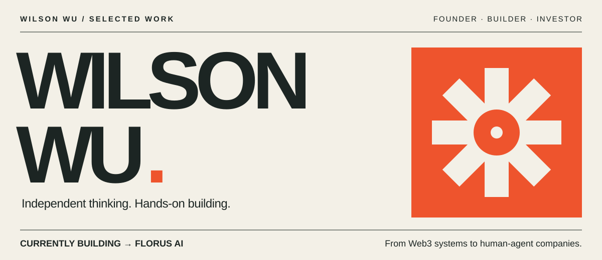
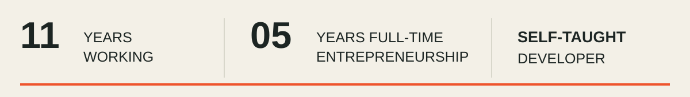
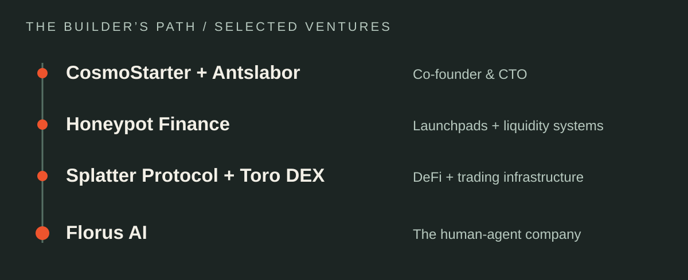
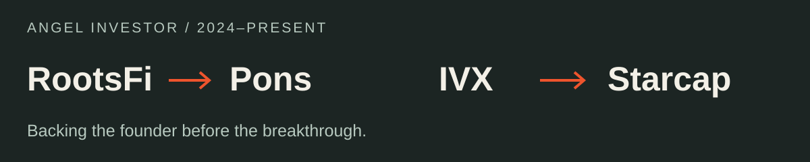
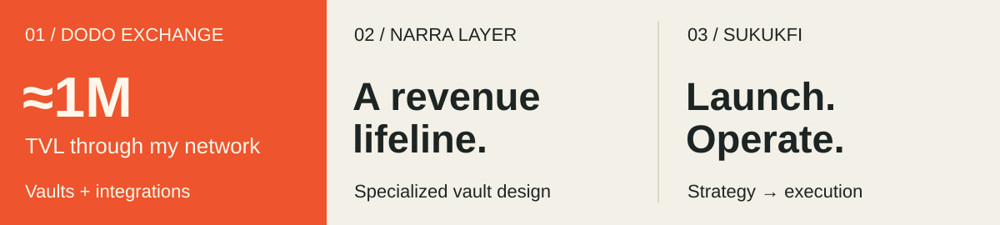

<a href="https://www.linkedin.com/in/wilson-wu-6a08893ba/"><strong>LINKEDIN ↗</strong></a> &nbsp; / &nbsp;
<a href="https://www.florus.ai/"><strong>FLORUS AI ↗</strong></a> &nbsp; / &nbsp;
<a href="#the-builders-path">VENTURES ↓</a> &nbsp; / &nbsp;
<a href="#backing-the-founder-before-the-breakthrough">INVESTING ↓</a> &nbsp; / &nbsp;
<a href="#working-alongside-founders">CONSULTING ↓</a>

### I build the product. And the business around it.

I'm **Wilson Wu**, founder of **Florus AI**, self-taught developer, angel investor and consultant. My path runs through launchpads, liquidity infrastructure and AI products. The thread connecting them: turning an original idea into something people can use.

A master's in **Logistics and Supply Chain Management** shaped how I think about systems. Teaching myself to code gave me a way to build them.

## NOW / Building the human-agent company

> **A customer asks a question. Sales learns something. Marketing should not have to discover it again.**

That is the direction of **Florus AI**: a self-improving AI front office connecting marketing, sales and customer service. **Our RSI agent workflow** is designed to execute work, measure results, review evidence and carry approved lessons into the next round.

<table>
<tr>
<td width="50%" valign="top">
<h3>01 / GEOCompanion</h3>
<strong>Be discoverable.</strong>

AI search visibility. Helping businesses understand how they appear in AI answers.

<a href="https://www.geocompanion.ai/"><strong>Explore GEOCompanion ↗</strong></a>
</td>
<td width="50%" valign="top">
<h3>02 / LaunchVibes</h3>
<strong>Get the idea out.</strong>

Content and distribution. Turning ideas into go-to-market work.

<a href="https://www.launchvibes.tech/"><strong>Explore LaunchVibes ↗</strong></a>
</td>
</tr>
</table>

**Live today:** our GTM loop through GEOCompanion and LaunchVibes.  
**In early access:** sales and customer-service loops.  
**What comes next:** developing the connections between them, toward small human-agent teams that can build and run much larger businesses.

<strong>＋ Program journey & the meaning of self-improvement</strong>

 

NVIDIA Inception · Startup Foundry · LvlUp Startup Excellence Tracks · AltaLab Online Sprint (completed).

Our approach is practical: retain useful evidence, review what worked and improve the next round. People remain accountable for brand, claims, pricing and spend. This describes our agent workflow and product direction, not frontier-model RSI or achieved superintelligence. Program participation is not investment or endorsement.

## The builder's path

<strong>＋ What I worked on</strong>

 

**Honeypot Finance · Founder**  
Launchpad and liquidity infrastructure in the Berachain ecosystem. Work spanning token launches, vaults and the mechanisms that connect projects with liquidity.

**CosmoStarter · Co-founder & CTO** / **Antslabor · Co-founder & CTO**  
Technical co-founding, product building and engineering leadership.

**Splatter Protocol / Toro DEX**  
DeFi product development on Scroll; trading infrastructure in the Sei ecosystem.

Building in crypto sharpened my interest in the parts outside the interface: incentives, risk, coordination and what happens when real people use a system.

## Backing the founder before the breakthrough

I began backing Web3 founders. I'm also looking at AI projects with strong fundamentals, thoughtful technical choices and a clear reason to exist.

### Field note / Why I backed Ozzy

I invested in **RootsFi** before knowing where Ozzy's breakthrough would happen. In my essay, I reflect on that early conviction and Pons's reported pace: **approximately two months to a $100M annualized revenue run-rate**, as shown in the comparison chart accompanying the piece.

[**Read my founder-investor story ↗**](https://x.com/honeypotfinance/article/2098053055354671235)

The article describes an annualized revenue pace, not verified recurring ARR. Its “fastest” comparison is the chart's claim, not an independently established universal ranking.

## Working alongside founders

<strong>01 / DODO Exchange — vaults, integrations & liquidity</strong>

 

Helped bring in approximately **1M in TVL through my network**, alongside **vault setup and multiple technical integrations on Berachain**.

<strong>02 / Narra Layer → Supernet AI — a revenue lifeline</strong>

 

Designed and helped build a **specialized vault** that generated almost all of the team's cash flow in 2025, helping them continue operating through a difficult market.

<strong>03 / SukukFi — from launch to operations</strong>

 

Advised on **launch and operating strategy**, connecting product decisions with practical execution.

My consulting work connects product design, technical execution and operating decisions. Sometimes that means designing the mechanism. Sometimes it means helping a team get it into the world.

## The workbench / Public code

<table>
<tr>
<td width="50%" valign="top">
<strong>01 / Solidity</strong>
<h3><a href="https://github.com/freeflowthought/ILO_backend">ILO backend ↗</a></h3>
Initial liquidity offering model.
</td>
<td width="50%" valign="top">
<strong>02 / Vue</strong>
<h3><a href="https://github.com/freeflowthought/splatter_front">Splatter frontend ↗</a></h3>
A DeFi interface.
</td>
</tr>
<tr>
<td width="50%" valign="top">
<strong>03 / TypeScript</strong>
<h3><a href="https://github.com/freeflowthought/refidea">Refidea ↗</a></h3>
Public TypeScript work.
</td>
<td width="50%" valign="top">
<strong>04 / Python</strong>
<h3><a href="https://github.com/freeflowthought/scrapeandcompare">Scrape & compare ↗</a></h3>
Data tools and experimentation.
</td>
</tr>
</table>

 

> ### More people with strong ideas should be able to build serious companies.
> That is the future I'm working toward with Florus.

**[Let's compare notes on LinkedIn ↗](https://www.linkedin.com/in/wilson-wu-6a08893ba/)**  
AI products · founder systems · technical execution · early-stage ideas
